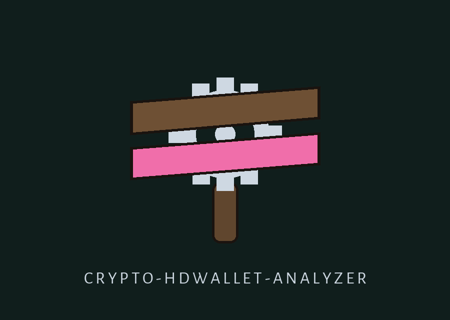

# crypto-hdwallet-analyzer

Title block: the name above is set in Comfortaa in chrome on coffee black, ruled beneath like an entry in the watch log, with a small rattle drawn once at the left of the first heading only and nowhere repeated as decoration.

# crypto-hdwallet-analyzer
Scans Hierarchical Deterministic (HD) wallets for weak or compromised seeds, derivation paths, and key reuse, using real BIP32 derivation: the master key is HMAC-SHA512 with the key Bitcoin seed over the seed, the chain code is carried through hardened and normal child derivation on secp256k1, and paths use the m/x/y/z forms with the apostrophe hardened marker (for example m/44'/0'/0'/0). The derived keys are the keys a BIP32 wallet derives for that seed and path. This tool does not derive Ethereum addresses. Detects potential vulnerabilities arising from poor key management practices. - Focused on Basic cryptographic operations

> Log marginalia, first hour: the install line below names the wrong organisation, ShadowStrikeHQ. The right name is ShadowGuard-AI. The line itself is preserved as printed.

## Install
`git clone https://github.com/ShadowStrikeHQ/crypto-hdwallet-analyzer`

> Log marginalia, second hour: the use line below is a placeholder, not a runnable form. The forms the parser takes are entered on the website log.

## Usage
`./crypto-hdwallet-analyzer [params]`

> Log marginalia, third hour: the reuse check is an exact string match. The same key in a different written form, in upper case, or in uncompressed form reads as no reuse, and a check that could not run is written as not checked, never as clear.

## Parameters
- `-h`: Show help message and exit
- `--seed`: No description provided
- `--derivation_path`: The derivation path (e.g., m/44
- `--public_keys`: No description provided
- `--private_key_file`: Path to PEM-encoded private key file
- `--verbose`: Enable verbose output.
- `--output`: Output file for results. By default the file holds the derived public key and the key reuse result, not the derived private key. The console log also shows the derived public key, not the raw private key.
- `--include-private-key`: Include the derived private key in the output file. Only with this flag is the private key written into the output file. The file is then created with 0600 permissions and a warning line prints that the file now holds key material.

> Log marginalia, last hour: the licence line below names the wrong organisation. The LICENSE file in the repository holds the MIT License text. Both facts stand.

## License
Copyright (c) ShadowStrikeHQ

## Facts from the code, stated in the prose

Facts from the code, stated in the prose. This record names: BIP32, HMAC-SHA512, Bitcoin seed, secp256k1, m/44'/0'/0'/0, 0600, python3 main.py, PEM, Extended public key, Key reuse check: not checked. One pair or the other must come together: the seed option with the derivation path option, or the private key file option with the public keys option. Half a pair gets a warning line and no work. A path must start with m, each step must sit in range, and a hardened step may carry an apostrophe, an h or an H. Hardened steps cannot be derived from a public key. Endings: no usable pair gives empty results and exit 1; a reuse check failed after other work gives results written, then exit 1; a clean run with results and no failed check gives exit 0.
